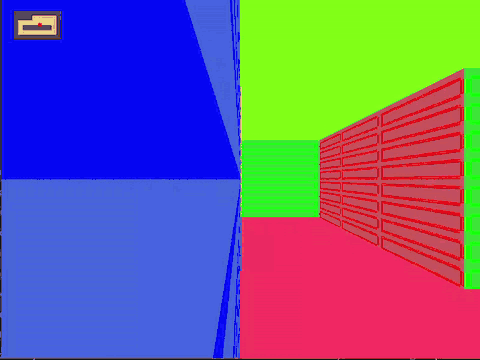
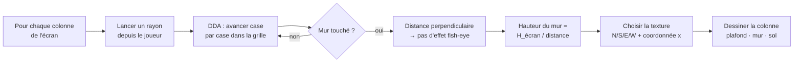

<div align="center">



<a href="https://git.io/typing-svg"></a>

<p>
  
  
  
  
  
</p>

<!-- 🎥 Remplace par un GIF de ton jeu (voir section "Créer le GIF" en bas) -->


</div>

---

## 🧭 Sommaire

- [À propos](#-à-propos)
- [Fonctionnalités](#-fonctionnalités)
- [Installation](#%EF%B8%8F-installation)
- [Contrôles](#-contrôles)
- [Format des cartes `.cub`](#%EF%B8%8F-format-des-cartes-cub)
- [Comment ça marche](#-comment-ça-marche--le-raycasting)
- [Structure du projet](#-structure-du-projet)
- [Auteurs](#-auteurs)

---

## 🎯 À propos

**cub3D** est un projet du cursus de l'**École 42** inspiré du légendaire *Wolfenstein 3D* (1992), le premier FPS de l'histoire.
L'objectif : créer une vue 3D « réaliste » d'un labyrinthe à partir d'une carte 2D, en utilisant la technique du **raycasting** — sans aucun moteur graphique, juste du C et la **MiniLibX**.

---

## ✨ Fonctionnalités

| Partie obligatoire | Bonus |
|---|---|
| ✅ Raycasting avec algorithme **DDA** | ⭐ Minimap en temps réel |
| ✅ Textures différentes pour N / S / E / W | ⭐ Collisions avec les murs |
| ✅ Couleurs du sol et du plafond | ⭐ Portes ouvrables |
| ✅ Parsing complet et sécurisé des `.cub` | ⭐ Sprites animés |
| ✅ Déplacements fluides + rotation | ⭐ Rotation à la souris |
| ✅ Gestion d'erreurs propre, zéro leak | |

> ✏️ Coche / décoche selon ce que tu as réellement implémenté.

---

## ⚙️ Installation

```bash
git clone https://github.com/TON_USERNAME/cub3D.git
cd cub3D
make            # partie obligatoire
make bonus      # avec les bonus
./cub3D maps/subject.cub
```

**Dépendances (Linux)** :
```bash
sudo apt-get install gcc make xorg libxext-dev libbsd-dev
```

---

## 🎮 Contrôles

<div align="center">

| Touche | Action |
|:---:|:---|
| <kbd>W</kbd> <kbd>A</kbd> <kbd>S</kbd> <kbd>D</kbd> | Avancer / gauche / reculer / droite |
| <kbd>←</kbd> <kbd>→</kbd> | Tourner la caméra |
| 🖱️ Souris | Tourner la caméra (bonus) |
| <kbd>E</kbd> | Ouvrir / fermer une porte (bonus) |
| <kbd>ESC</kbd> | Quitter |

</div>

---

## 🗺️ Format des cartes `.cub`

```text
NO ./textures/north.xpm
SO ./textures/south.xpm
WE ./textures/west.xpm
EA ./textures/east.xpm

F 220,100,0
C 225,30,0

        1111111111111111111111111
        1000000000110000000000001
        1011000001110000000000001
        1001000000000000000000001
111111111011000001110000000000001
100000000011000001110111111111111
11110111111111011100000010001
11110111111111011101010010001
11000000110101011100000010001
10000000000000001100000010001
10000000000000001101010010001
11000001110101011111011110N0111
11110111 1110101 101111010001
11111111 1111111 111111111111
```

- `1` = mur · `0` = sol · `N/S/E/W` = position et orientation de départ du joueur
- La carte doit être **entièrement fermée** par des murs.

---

## 🧠 Comment ça marche : le raycasting



<details>
<summary><b>📐 Les maths en détail (clique pour déplier)</b></summary>

<br/>

Pour chaque colonne `x` de l'écran :

```c
camera_x = 2 * x / (double)WIN_W - 1;          // de -1 à 1
ray_dir  = dir + plane * camera_x;             // direction du rayon

delta_dist.x = fabs(1 / ray_dir.x);            // distance entre 2 lignes verticales
delta_dist.y = fabs(1 / ray_dir.y);            // distance entre 2 lignes horizontales

// DDA : on avance toujours vers la ligne de grille la plus proche
while (!hit)
{
    if (side_dist.x < side_dist.y)
        { side_dist.x += delta_dist.x; map.x += step.x; side = 0; }
    else
        { side_dist.y += delta_dist.y; map.y += step.y; side = 1; }
    hit = (map[map.y][map.x] == '1');
}

perp_dist   = (side == 0) ? side_dist.x - delta_dist.x
                          : side_dist.y - delta_dist.y;
line_height = (int)(WIN_H / perp_dist);
```

Le vecteur `plane` (perpendiculaire à `dir`) définit le **FOV** : avec `|plane| = 0.66`, on obtient ~66°.

</details>

---

## 📁 Structure du projet

```text
cub3D/
├── 📂 includes/     # headers (.h)
├── 📂 srcs/
│   ├── parsing/     # lecture et validation du .cub
│   ├── raycasting/  # DDA, calcul des distances
│   ├── render/      # dessin des textures, minimap
│   └── events/      # clavier, souris, fermeture
├── 📂 maps/         # cartes de test (valides + invalides)
├── 📂 textures/     # fichiers .xpm
├── 📂 libft/
├── 📂 minilibx/
└── Makefile
```

---

## 👥 Auteurs

<div align="center">

<table>
  <tr>
    <td align="center">
      <a href="https://github.com/TON_USERNAME">
        <br/>
        <sub><b>Ton Nom</b></sub>
      </a><br/>
      <sub>Raycasting · Rendu</sub>
    </td>
    <td align="center">
      <a href="https://github.com/USERNAME_BINOME">
        <br/>
        <sub><b>Nom du binôme</b></sub>
      </a><br/>
      <sub>Parsing · Events</sub>
    </td>
  </tr>
</table>

<br/>


⭐ *Si ce projet t'a aidé, laisse une étoile !*

</div>

<!--
═══════════════════════════════════════════════
🎥 CRÉER LE GIF DE DÉMO (à supprimer ensuite)
═══════════════════════════════════════════════
1. Enregistre ton écran pendant que tu joues (OBS, Peek, ou `byzanz-record` sous Linux)
2. Convertis en GIF léger :
   ffmpeg -i demo.mp4 -vf "fps=15,scale=720:-1:flags=lanczos,split[a][b];[a]palettegen[p];[b][p]paletteuse" -loop 0 assets/demo.gif
3. Vise < 10 Mo pour que GitHub l'affiche bien.
-->
